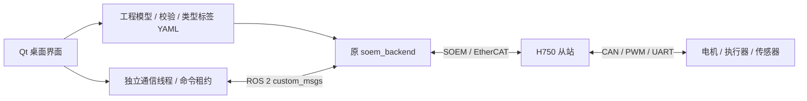

# Ecat GroundStation

当前版本 **v0.3.1**：修复打开 root 终端时的 Qt 返回值异常；启动前核对源文件和安装文件，阻止使用未编译的新配置；root ROS 日志保存到工作空间，方便排查。详见 [Launch 排查与修复](docs/LAUNCH_FIX.md)。v0.3.0 的 [配置应用与编译](docs/CONFIG_WORKFLOW.md)、[EEPROM 修复说明](docs/EEPROM_FIX.md) 与 [首次配置说明](docs/FIRST_SETUP.md) 继续适用。

面向 [AIMEtherCAT/EcatV2_Master](https://github.com/AIMEtherCAT/EcatV2_Master) 的本地桌面上位机，采用 Python 3.10 + PyQt5 + ROS 2。界面参考 QGroundControl 的设备工程、参数配置、状态监控与独立调试窗口组织方式。


## 在这台电脑上启动

双击桌面 **Ecat GroundStation**，或执行：

```bash
/home/hby/ecat_groundstation/run.sh
```

启动时恢复上次已应用的工作空间工程；没有已应用工程时打开示例，处于离线编辑状态。右上角选 **离线演示 → 连接**，再到 **执行器调试** 双击任务，可体验独立窗口、命令编辑与模拟反馈。

本机已有 ROS 2 Humble、PyQt5、PyYAML 和构建完成的 `custom_msgs`；`run.sh` 自动加载 `/opt/ros/humble/setup.bash` 和 `/home/hby/Rolling_ZLT/install/setup.bash`。

导入现有机器人配置：

```bash
/home/hby/ecat_groundstation/run.sh \
  --config /home/hby/Rolling_ZLT/src/soem_bringup/config/config.yaml
```

仅查看配置不会发送硬件命令。该本机配置的 `sn2555957` 需要 82 B 反馈 PDO，超出标准版 80 B；导入时提示使用 Large PDO，必须核对实物确为产品代码 4。YAML 本身不含模块型号，JSON 工程会保存所选型号。

## 已实现

| 页面 | 功能 |
|---|---|
| 工作台总览 | 配置拓扑、从站与任务统计、校验状态、PDO/SDO 使用量 |
| 首次配置 | 实时内核与 CPU 检查、工作空间与 bringup、EEPROM、H750/IMU、SN 发现；位于导航第二项 |
| 从站与任务 | 任务编辑、自动校验并写回工作空间 YAML、备份、普通用户 colcon build 与实时日志 |
| 执行器调试 | ROS Domain、独立窗口、消息字段与范围校验、按住运行、反馈曲线与 CSV |
| 配置与日志 | 带 C++ 类型标签的 YAML 导入/导出、JSON 工程、原子保存、校验报告、进程日志 |

支持的任务：DJI RC、LK 电机（8 种模式）、HIPNUC IMU、DSHOT600、DJI 电机组、板载 PWM、外置 PWM、MS5837-30BA、PMU、SBUS、DM 电机（MIT/位置限速/速度）、超级电容、VT13、DD 电机组（4 种模式）。ADC 任务 9 未被当前主站实现，导入时明确拒绝；SBT908E 等第三方从站暂未做专用编辑器。

配置细节以仓库代码和官方 TaskEditor 为准：控制周期单位为 **ms**；板载 PWM/DSHOT 使用 **Port 1 / Port 2** 编码；断连动作 **1 = 保持最后值，2 = 恢复初值**。PWM 信号周期和脉宽单位为 μs。DM 的 P/V/T Max 必须与电机固件一致。

## 连接真实电机或执行器

1. 在 **首次配置** 获取真实 SN，点击 **进入从站任务配置**；工作空间、网卡和 CPU 自动带入。也可在任务页选择已有工作空间。
2. 编辑实际型号、端口、CAN ID、控制模式及话题，然后点 **应用任务修改**。软件先校验并备份，再自动替换 `src/soem_bringup/config/config.yaml`，界面显示实际写入路径。
3. 点击同一页的 **colcon build（普通用户）**，查看实时日志，等待“安装配置已更新并核对一致”。运行中的主站需先停止；编译不会自动启动电机。
4. 从 **首次配置 → Bringup 与首次运行** 打开 root 终端，手动执行 `ros2 launch soem_bringup bringup.launch.py` 加载新配置。已有一致主站时可直接连接。
5. 在 **执行器调试** 选择正确的 ROS_DOMAIN_ID，右上角选 **ROS 2 实机 → 连接**，再打开任务窗口。确认反馈有效和话题匹配后勾选允许输出，按住运行。

也可手工导出 YAML。应用任务时会自动保存完整工程快照，下次启动恢复上次已应用的工作空间工程。配置变更需要重启主站：界面区分“文件已写入”“安装配置已编译更新”与“主站重新加载”。连接中的编辑会锁定。

主站启动仍依赖原仓库要求的实时内核、CPU 设置和网卡访问权限。首次配置中的系统修改和烧录通过桌面管理员认证执行，工作空间编译使用普通用户；连接 ROS 本身不会启动主站。`run.sh` 支持 `ECAT_WORKSPACE` 和 `ECAT_ROS_SETUP` 环境变量以切换工作空间与 ROS 安装。启动整个 GUI 时应加载与主站一致的 `custom_msgs`。

### 输出与停止行为

- ROS 命令发送频率为 20 Hz；MCU 控制周期由 YAML 的 `sdowrite_control_period` 单独决定。GUI 不承担 1 kHz 实时控制环。
- 通信工作线程独立于界面，命令租约为 300 ms；带反馈任务要求反馈年龄不超过 600 ms，且在线/故障标志正常。过期或故障会撤销授权，恢复通信后仍需重新授权，禁止自动重放命令。
- 同一命令话题发现其他发布者时，禁止本上位机控制，避免控制源竞争。
- DM、DJI、DD 和 LK 单电机模式释放时发送 `enable=0`；LK 广播模式发送零电流；超级电容发送禁用；PWM/DSHOT 恢复配置初值。释放消息在短时间内重复发送，ROS 2 的 best effort 通道仍不提供必达保证。
- **PWM 的 1500 μs 只是示例值，可能对应中位、运动或其他动作。请为具体执行器设置正确的释放初值。** DSHOT 1–47 属于特殊命令，调试界面拒绝发送。
- 软件停止不能替代硬件急停。进程被强制杀死、整机失电或网络断开时，禁用消息可能无法送达；原主站会保留最后一次 ROS 命令，必须有独立的主站/固件命令超时机制和硬件急停。当前上位机未修改原主站的看门狗实现。

### 与当前主站实现的兼容限制

源码中的 DJI/DD `init_value()` 固定写四个槽位共 12 B，而正常命令按启用槽位压缩。为避免初始化越界/覆盖，本软件要求：**部分启用的电机组位于全部输出任务末尾，且其起始偏移后仍有至少 12 B 可用空间**。可将 PWM 等输出任务移到该电机组前面。原主站源码保持不变。

配置拓扑来自工程，不是 EtherCAT 总线扫描。ROS 发现和有效反馈不构成固件配置回读验证。首次配置已提供 EEPROM 烧写和网线变化检测；没有实现从站端口自动枚举或主站任务热更新。

## 架构



`schema.py` 定义任务字段和协议布局；`config.py` 负责配置模型与 YAML；`commands.py` 处理命令字段和范围；`bridge.py` 负责 ROS 与演示模式；`app.py`、`widgets.py` 实现桌面交互。

## 在其他 Ubuntu / ROS 2 Humble 电脑上使用

```bash
sudo apt install python3-pyqt5 python3-yaml python3-pytest
source /opt/ros/humble/setup.bash
source /path/to/ecat_ws/install/setup.bash
cd /path/to/ecat_groundstation
python3 -m ecat_groundstation
```

ROS 的 `rclpy`、`custom_msgs` 通过 ROS 工作空间提供，不通过 pip 安装。也可作为 `ament_python` 包构建：

```bash
colcon build --base-paths /path/to/ecat_groundstation --packages-select ecat_groundstation
source install/setup.bash
ros2 run ecat_groundstation ecat-groundstation
```

## 验证

```bash
source /opt/ros/humble/setup.bash
source /home/hby/Rolling_ZLT/install/setup.bash
cd /home/hby/ecat_groundstation
QT_QPA_PLATFORM=offscreen python3 -m pytest -q
```

测试覆盖所有支持任务与控制模式的 YAML 往返、容量/资源/话题错误、实际 yaml-cpp 读取、已安装 ROS 消息类型、Qt 任务编辑与窗口操作，以及隔离 DDS Domain 中的 DM 命令/反馈/租约超时/反馈超时。隔离测试不启动 EtherCAT 主站、不打开原始网卡、不接触真实执行器。未做真实电机台架验收。

v0.1.0 验证：48 项测试通过；`colcon build`、安装入口及 wheel 构建成功。v0.2.0 增加首次配置相关测试，并实际编译三份独立 IMU ELF、生成并构建临时 bringup 包；详见 [验证说明](docs/FIRST_SETUP.md#本次验证)。原 EcatV2_Master 工作树无修改。

v0.3.0 验证：116 项测试通过，软件包 `colcon build` 和 wheel 构建成功。测试在临时工作空间中实际创建、编译 bringup，修改任务后再次编译并核对安装 YAML，同时覆盖自动系统检查和新的导航顺序；没有覆盖本机机器人配置或执行硬件操作。

v0.3.1 验证：123 项测试通过，软件包 `colcon build` 和 wheel 构建成功。使用本机 EGC_test 当前配置做了短时真实 launch：SN2818120、SDO 21 B、OP、初始化成功、从站 ready，随后正常停止并退出；未发送 GUI 控制指令。详见 [Launch 排查与验证](docs/LAUNCH_FIX.md)。

本机配置导入用于兼容检查，未覆盖原文件。演示文件位于 `examples/`，界面截图位于 `artifacts/`。

## 协议来源

- EcatV2_Master 本机检出的提交：`7c1bd8a3c7f47cc8505470640f8dd7baf5698d76`。
- [主站任务实现](https://github.com/AIMEtherCAT/EcatV2_Master/tree/main/src/soem_wrapper/src/tasks)、[消息定义](https://github.com/AIMEtherCAT/EcatV2_Master/tree/main/src/custom_msgs/msg)。
- [官方 TaskEditor 配置生成器](https://github.com/AIMEtherCAT/TaskEditor/blob/master/src/utils/generate-module-def.js)、[控制周期单位](https://github.com/AIMEtherCAT/TaskEditor/blob/master/src/components/ControlPeriodInput.vue)、[端口编码](https://github.com/AIMEtherCAT/TaskEditor/blob/master/src/components/PortSelector.vue)、[断连动作](https://github.com/AIMEtherCAT/TaskEditor/blob/master/src/components/ConnectionLostActionSelector.vue)。

新代码按 LGPL-2.1-or-later 提供；所带消息字段表来自上述 EcatV2_Master，参见 `THIRD_PARTY_NOTICES.md` 和 `LICENSE`。
