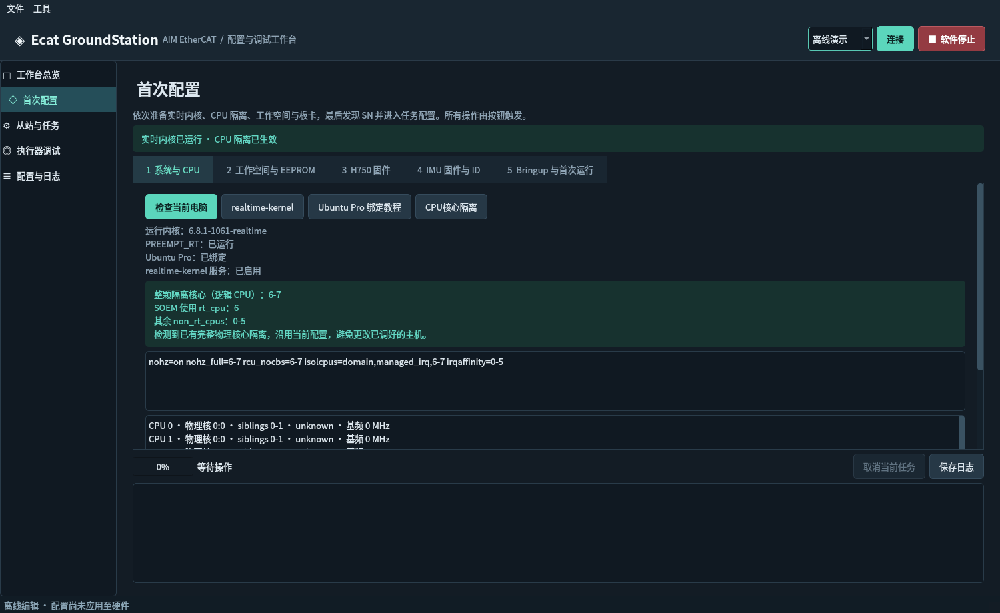
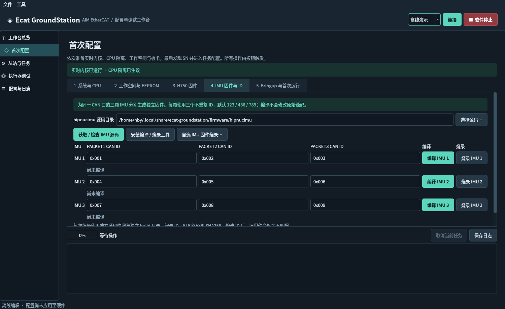

# 首次配置（v0.2.0）

从左侧第二项 **首次配置** 进入。也可直接打开这个模块：

```bash
/home/hby/ecat_groundstation/run.sh --first-setup
```

模块提供五个页签和共同的实时日志。检查、配置、下载、编译与烧录均由对应按钮触发；打开软件不会安装内核、修改 GRUB 或烧录硬件。



## 1. 实时内核与 CPU 核心隔离

**realtime-kernel** 会先重新检查本机：

- 已运行 `/sys/kernel/realtime=1`：显示已就绪，不重复安装。
- Ubuntu Pro 未绑定：显示 Ubuntu One / Pro Dashboard 引导，可打开官方 `pro attach` 交互终端。账号绑定由 Ubuntu Pro 完成，上位机不收集 token。
- Pro 已绑定但服务未启用：经系统管理员认证执行 `pro enable realtime-kernel --assume-yes`。
- 安装已完成而当前仍是普通内核：提示保存工作并重启，必要时在 GRUB 选择 realtime 内核。不会自动重启电脑。

**CPU核心隔离** 同样先检查实际系统状态。软件读取 sysfs 物理核心、超线程兄弟关系、在线 CPU、P/E 核类型和可用基础频率：

1. 已有完整物理核心隔离时优先沿用，不覆盖调好的主机设置。
2. 混合架构优先选基础频率严格超过 2 GHz 的 E 核；否则选 P 核。无法取得 E 核基础频率时不会把睿频当作基础频率。
3. 普通架构选择一整颗物理核心，保留 CPU0 作为系统 housekeeping。教程允许使用 CPU0；本软件选择保留它，以便系统调度及完整 nohz 工作。
4. 按真实 `thread_siblings_list` 隔离同一物理核心的全部线程，不假设编号相邻。至少保留另一颗物理核心给系统；只有一颗物理核心时拒绝自动隔离。

界面显示完整隔离 CPU 列表、用于 SOEM 的单个 `rt_cpu`、其余 `non_rt_cpus` 及启动参数预览：

```text
nohz=on nohz_full=X rcu_nocbs=X isolcpus=domain,managed_irq,X irqaffinity=Y
```

修改通过本软件自己的 `/etc/default/grub.d/99-ecat-groundstation.cfg` 完成，保留其它启动参数；先备份到 `/var/backups/ecat-groundstation/<时间>/`，再 `update-grub` 和 `grub-script-check`。生成失败会恢复此前片段并重新生成 GRUB。不会修改 BIOS、固定 CPU 频率或替换已有调优服务。

**重启后再点「检查当前电脑」**：根据运行内核、`isolated`、`nohz_full`、`rcu_nocbs`、`irqaffinity` 验证，不把“文件已写入”当成“设置已生效”。状态文件记录重启前 boot ID，尚未重启时会提示。

本机检查结果为：实时内核 `6.8.1-1061-realtime`；CPU **6–7** 整体隔离；SOEM 可使用 **CPU6**，其余 CPU 为 **0–5**。这是现有系统状态，此次开发没有重写该隔离设置。

## 2. 创建工作空间与刷写 EEPROM

输入例如 `EGC_ws`，点击 **确定 · 创建工作空间**：

```text
~/EGC_ws/
  .git/
  .gitmodules
  src/
    EcatV2_Master/
```

自动执行 `git init`、`git submodule add https://github.com/AIMEtherCAT/EcatV2_Master.git src/EcatV2_Master` 和 `git submodule update --init --recursive`。本软件创建的工作空间可重试；不自动覆盖同名已有工程，也不把已有工作空间根目录切换为 root。

`tools/*` 属于普通用户，因此直接设置执行位，无需 `sudo su` 后再 `exit`。Git、源码修改、ROS 包生成与编译全程由普通用户执行。

**网口检测**：接着网线检测一次，拔线后再检测一次。除了 operstate，还比较 carrier，因此即使网卡行政状态仍是 UP，也能识别物理链路变化。只出现一个变化时自动选中；多个网口变化时要求用户选择。然后重新接好 EtherCAT IN 网线与 Type-C 逻辑供电。

选择标准版或 Large PDO EEPROM，也可自选 BIN；从站链位置默认 **1**。点击 **刷写eeprom** 时确认具体网口、板位置与镜像，经系统认证执行：

1. 先以普通用户构建带逐字校验的 EEPROM 工具，使用当前 SOEM 子模块。
2. 管理员授权后 `-r` 备份，再 `-w` 逐字补写；每字回读确认，失败时有限重试。
3. 再 `-r` 全量回读，比对完整镜像。新增只读诊断按钮可仅比较、不写入。

原工具在某些错误下仍返回 0，因此 v0.2.1 使用本软件的逐字校验工具，详见 [修复说明](EEPROM_FIX.md)。备份在 `/var/backups/ecat-groundstation/eeprom/<时间>/`，操作日志自动保存在 `~/.local/share/ecat-groundstation/logs/`。完成后提醒 EtherCAT 板逻辑电源断电再上电。

## 3. H750 固件窗口

默认打开 **选择本地固件并烧录**，直接选择已有 ELF / HEX / BIN 即可，不需要源码或编译工具链。另有独立的 **本地源码编译（可选）** 页签：可自选源码工作空间、输出目录、工具链、目标名称和构建类型。编译成功后，再自主选择产物带入烧录页；编译及设置变化不会替换已经选择的固件。也可点击 **获取 / 检查 H750 源码** 获取官方工程与 SOES 子模块。完整说明见 [H750 本地编译](H750_BUILD.md)。

手动选择已有固件、独立烧录窗口、ST-Link 检测、halt、烧录与回读校验继续保留。

选择本机 `.elf` / `.hex` / `.bin` 固件，检测 ST-Link；多个探针时选择序列号。未连接时才提示连接。默认 400 kHz，使用 H750/H7 target：

```text
init → halt → 检查 MCU device ID → flash probe/info
→ flash write_image erase → verify_image → shutdown
```

不在烧录前执行 `reset halt`，也不在成功后自动复位 H750；这与提供的 H750 教程中实际可用方案一致。完成后请按 RESET 或重新上电。

MCU 检查也会暂停芯片，不只是 USB 枚举。文件会先检查 ARM ELF32、实际加载范围、Flash 边界；BIN 的加载地址可以修改，ELF/HEX 自带加载地址。当前界面针对文档中的 H750 128 KiB 内部 Flash 与 G431 128 KiB Flash，不作为其它 MCU 的通用烧录器。

烧录结果要求同时存在写入和回读校验成功信息，并且 OpenOCD 退出码为 0；只出现 `shutdown` 不会显示成功。

## 4. IMU 独立 ID 编译与逐块烧录



点击 **获取 / 检查 IMU 源码** 克隆 `AIMEtherCAT/hipnucimu`；也可选择自己的已有源码。三个默认配置为：

| 固件 | PACKET1 | PACKET2 | PACKET3 |
|---|---:|---:|---:|
| IMU 1 | 0x001 | 0x002 | 0x003 |
| IMU 2 | 0x004 | 0x005 | 0x006 |
| IMU 3 | 0x007 | 0x008 | 0x009 |

所有 ID 可编辑，支持十六进制和十进制；同一总线全部九个 ID 必须互不重复，范围为 1–0x7FF。

每个 **编译 IMU n** 按钮：

- 在独立目录复制源码，精确修改 `Core/Src/main.c` 的三个 `PACKETn_CAN_ID` 定义；不改动原工程。
- 创建全新的构建目录执行 CMake Release，编译 `hipnucimu.elf`。
- 检查 ELF，记录 ID、原仓库提交、ELF 绝对路径与 SHA256 到 manifest。
- 本次构建失败时撤销旧产物在当前行的有效标记；不会把旧 ELF 当成本次结果。

**安装 IMU 编译依赖** 只补齐 CMake、Make、ARM GCC、Newlib 和 Python venv，禁用 APT 推荐依赖，不安装大型 ARM C++ 标准库。烧录窗口中的 **安装 OpenOCD** 只安装烧录工具。已经安装的依赖不会重复安装或升级；全部齐全时无需下载。当前仓库要求 CMake ≥3.29；若系统版本较老，编译按钮在当前用户目录建立独立 Python venv，安装 `cmake>=3.29,<4`，不替换系统 CMake。需要联网下载缺失的工具或源码。

产物默认在 `~/.local/share/ecat-groundstation/imu-builds/`。点击对应 **烧录 IMU n**，自动选择该 ID 对应的 ELF，并核对 SHA256；修改 ID 后必须重新编译。也支持自选已有固件。

每次只连接并确认正在处理的那块 IMU；STM32G431 默认 1000 kHz，使用 G4 target，按 `reset halt → 擦写 → verify → reset run` 执行。上位机不能从探针 USB 序列号自动判断你把 SWD 线接到了哪颗 IMU。

## 5. Bringup、编译和发现 SN

选择 ROS 2 发行版并点击 **Creat bringup package**，软件自动重新检查实时内核和核心隔离。已经生效时直接继续生成，无需返回系统页手动确认；缺失时显示实际未通过的项目。生成：

```text
src/soem_bringup/
  CMakeLists.txt                  # 自动加入 install(DIRECTORY launch config …)
  package.xml                    # 正确的 Python 运行依赖
  config/config.yaml             # 教程的 SN 发现示例
  launch/bringup.launch.py        # 自动填入 interface / rt_cpu / non_rt_cpus
```

已有用户包不会被覆盖。本软件生成的文件若已被用户修改，也拒绝覆盖；允许重复执行未被修改的生成步骤。

按要求保留教程的简化 YAML（`sn2228293`、SDO 2 B、单个 type 3 任务），**它只用于获取实际 SN，不是当前主站 ABI 的最终运行配置**。找到真实 SN 后点击 **进入从站任务配置**，软件会生成完整 IMU 任务和正确的 15 B SDO，再由原有编辑器继续增加设备、端口和任务。

**colcon build** 在普通用户、所选工作空间根目录执行，日志实时显示。成功后默认自动打开独立 root 终端，已进入该目录并 source `/opt/ros/<版本>/setup.bash`、`install/setup.bash`。在那里由你手工执行：

```bash
ros2 launch soem_bringup bringup.launch.py
```

v0.3.1 起，打开 root 终端之前会核对源目录和安装目录中的 YAML、launch 文件，若不同则提示先编译。新终端的 ROS 日志保存到 `<工作空间>/.ecat-groundstation/ros-logs/`，终端关闭后仍可读取。

把 `Found slave id=1, sn=...` 日志粘回软件并点 **提取 SN**，或直接输入 SN。再点 **进入从站任务配置**，自动带入工作空间、所选 EEPROM 模型、网卡、CPU 设置和 IMU ID。配置任务后点击 **应用任务修改**，YAML 会自动写回该工作空间，再点击 **colcon build（普通用户）** 编译并验证安装文件。详见 [配置应用与编译](CONFIG_WORKFLOW.md)。

## 管理员授权与执行边界

系统操作经 `pkexec` 弹出桌面管理员认证窗口。管理员密码由系统处理，软件不缓存、落盘或记录密码；是否复用授权取决于系统认证策略。root 终端也使用该认证方式。需要桌面 polkit 认证代理、`pkexec` 和 `x-terminal-emulator`。

编译和下载任务可取消；系统修改与正在进行的擦写不可从 GUI 中途取消，结束前阻止关闭主窗口。执行修改或烧录前要停止 `soem_backend`；连接中的上位机也禁止启动这些任务。内核安装、EEPROM、Flash 都有单独结果验证。烧录成功仅代表写入与回读校验，不代表板卡功能或执行器安全验收。

## 本次验证

自动化测试结果：**93 项通过**；v0.2.0 的 ROS 2 包构建成功。

- 实际读取本机 Pro、实时内核和完整超线程隔离状态，输出不含 Pro 账号、token、订阅标识。
- 真正执行临时工作空间中的 `ros2 pkg create`、生成文件、`colcon build` 并检查安装产物。
- 对上游 `hipnucimu` 提交 `406e6851f5071db2f1ffeff294d03e6dc43ed446`，实际交叉编译三份独立固件（123 / 456 / 789）；构建使用临时工具链，没有系统安装 ARM 编译器。
- 管理员改系统、EEPROM、ST-Link 擦写使用模拟工具与临时目录验证；此次开发没有执行真实内核切换、GRUB 修改、EEPROM 或 MCU 烧录。硬件端到端验收尚待接板操作。

## 依据

- [Environment setup](https://github.com/AIMEtherCAT/EcatV2_Master/blob/main/docs/environment-setup.md)
- [First-run test](https://github.com/AIMEtherCAT/EcatV2_Master/blob/main/docs/first-run-test.md)
- [H750 烧录教程](https://github.com/ssybh2/Linux-cmd-Guidance/blob/main/H750_FLASHING.md)
- [STM32G431 / OpenOCD 教程](https://github.com/ssybh2/Linux-cmd-Guidance/blob/main/STLINK_OPENOCD.md)
- [IMU 源码](https://github.com/AIMEtherCAT/hipnucimu)
