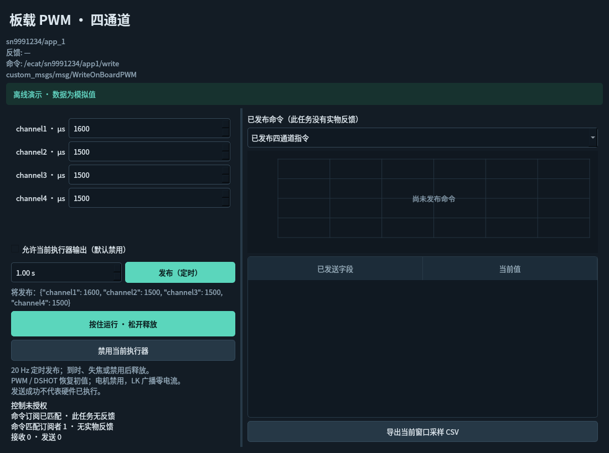
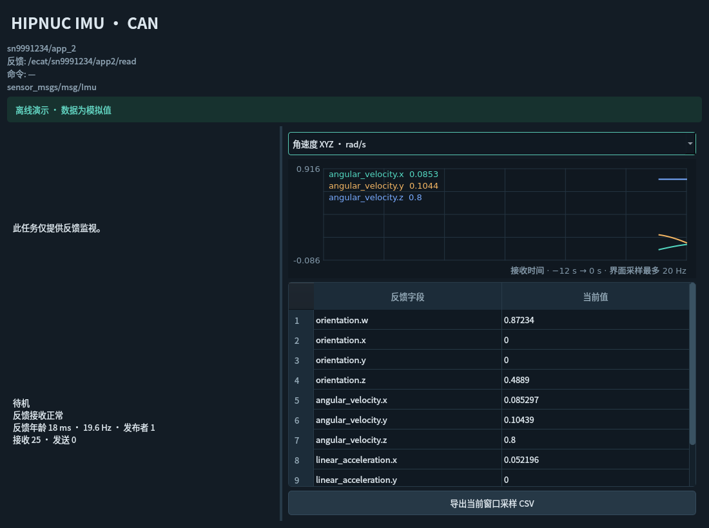

# v0.4.5 发布与反馈链路

排查所用主站日志确认 `Rolling_ZLT` 两块 Large PDO 从站（SN 1966141、2555957）进入 OP，SDO 已确认收到，系统启动成功。软件中的 PWM 和 IMU 话题名称、类型与配置一致。用户随后关闭主站，因此本次没有重启 EtherCAT、发送实体电机指令，也没有声称验证实体转动或 IMU 实际读数。

## 发布

此前修改数值仅编辑表单，必须允许输出并按住运行。现在另有 **发布（定时）**：允许当前执行器输出后点击，以 20 Hz 发送表单中的完整消息，持续指定时间（默认 1 秒，0.1–10 秒）。显示实际 JSON 字段、匹配订阅者、发送数和阻止输出的原因。到时、失焦、关闭窗口或禁用后恢复释放值；原按住运行方式保留。

板载 PWM 使用 `custom_msgs/msg/WriteOnBoardPWM` 的 `channel1` 到 `channel4`，单位 μs。例如只改 channel1 为 1600 时，其余通道保留配置初值。主站直接将这四个 uint16 写入 PDO。发送计数表示 ROS 消息发布成功，不能确认硬件执行；这里没有电机反馈。

无反馈任务的右侧曲线和字段表展示实际已发布的命令，明确标注不属于实物反馈。IMU 曲线展示接收到的消息，二者按任务类型自动区分。

此操作参考 Foxglove [Publish panel](https://docs.foxglove.dev/docs/visualization/panels/publish) 的明确发布动作，保留本软件的短时授权、发布者冲突保护和释放行为，不提供无限保持输出。

## IMU 与诊断

订阅真实 `sensor_msgs/msg/Imu`，采用兼容主站 `SensorDataQoS` 的 best effort 订阅。可同时绘制角速度 XYZ、加速度 XYZ、四元数 WXYZ，也能选择单个字段；横轴使用单调接收时间，展示最近 12 秒的界面采样。显示完整字段表、接收频率、消息数量、数据年龄，支持 CSV。

任务列表和 **检查话题链路** 区分：未发现发布者/订阅者、类型不匹配、发现发布者但无数据、数据过期、正常收发、其他控制发布者冲突。仅创建 ROS 节点不再显示为主站链路已接通。无反馈的 PWM 不再显示“无有效反馈”。曲线组织参考 Foxglove [Plot panel](https://docs.foxglove.dev/docs/visualization/panels/plot)。

## root 与普通用户的传输

主站需要 root，GUI 使用普通用户。Fast DDS 官方记录了混合权限进程之间的共享内存访问问题；这能造成发现端点却无法收发。见 [Shared Memory Transport](https://fast-dds.docs.eprosima.com/en/2.x/fastdds/transport/shared_memory/shared_memory.html)。本机停机前没有保存端点数据，故这仍是待实机复验的可能原因，不把它认定为已证明的唯一原因。

GUI 和新开的首次配置 root 终端默认使用包内的 UDPv4 XML profile，关闭内置 SHM，配置方式见 [Fast DDS UDP Transport](https://fast-dds.docs.eprosima.com/en/2.6.x/fastdds/transport/udp/udp.html)。不修改全局 ROS、网络、共享内存权限或用户 shell 文件；自定义 DDS profile 和其它 RMW 保留。旧进程不会自动改变传输，需要关闭旧控制连接、使用新 GUI 和新 root 终端重新启动。软件不会自动启动主站或发送任务指令。

## 验证

隔离 DDS Domain（205–224）中的独立模拟主站进程接收真实 `WriteOnBoardPWM`，发布真实 `Imu`。测试点击 UI 发布，核对 `[1600,1500,1500,1500]`、到时恢复 `[1500,1500,1500,1500]`，核对编辑数值不发送、失焦停止、IMU 多轴绘图与频率统计。模拟进程不含 EtherCAT、原始网卡或实体执行器代码。
